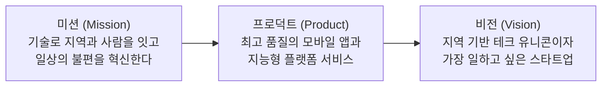

# 01. 회사 소개 및 핵심 가치 (Company & Core Values)

> **"충남에서 시작해 대한민국을 넘어 글로벌 모바일 생태계를 혁신합니다."**  
> 충남스타트앱컴퍼니에 오신 것을 진심으로 환영합니다.  
> 본 문서는 우리가 왜 존재하며, 어떤 목표를 향해 나아가고, 어떤 가치를 기준으로 일하는지 소개합니다.

---

## 1. 회사 개요 (About Us)

- **회사명**: 주식회사 충남스타트앱컴퍼니 (Chungnam StartApp Company Inc.)
- **설립 미션**: 지역 거점의 기술적 한계를 뛰어넘어, 일상 속 문제를 해결하는 고도화된 모바일 플랫폼과 소프트웨어 솔루션을 만듭니다.
- **주요 사업 영역**:
  - 모바일 앱 플랫폼 개발 및 서비스 운영
  - 하이퍼로컬(Hyper-local) 라이프스타일 커머스 & 모빌리티 솔루션
  - AI 기반 데이터 분석 및 B2B 모바일 SaaS 설루션
- **오피스 위치**: 충청남도 천안시 서북구 불당동 스타트업 타워 (KTX 천안아산역 인근)

---

## 2. 우리가 해결하는 문제와 프로덕트

우리는 기술을 통해 사람들의 일상을 더 편리하고 풍요롭게 만드는 제품을 만듭니다.

### 📱 대표 프로덕트 라인업
1. **충남로컬모아 (Chungnam Local Moa)**
   - 충남 지역 소상공인과 주민을 스마트하게 연결하는 로컬 커머스 & 커뮤니티 플랫폼
   - 실시간 위치 기반 혜택, 스마트 오더, 로컬 콘텐츠 큐레이션 제공
2. **스마트 무브 충남 (Smart Move)**
   - 지역 산업단지 및 도심 맞춤형 스마트 카풀 & 모빌리티 셔틀 연계 플랫폼
   - 대중교통 사각지대를 해소하고 통퇴근 시간을 획기적으로 단축
3. **앱스택 AI (AppStack AI - R&D)**
   - 앱 개발자 및 운영사를 위한 실시간 앱 로그 및 사용자 이탈 예측 AI SaaS 도구

---

## 3. 우리의 미션과 비전

- **Mission (사명)**: 모바일 기술과 데이터를 융합하여 지역의 경계를 허물고, 모든 사용자가 쉽고 직관적으로 누릴 수 있는 디지털 가치를 창조한다.
- **Vision (비전)**: 대한민국을 대표하는 로컬-글로벌 모바일 테크 기업으로 성장하며, 자율과 성장을 바탕으로 동료가 최고의 성과를 낼 수 있는 조직이 된다.

---

## 4. 4대 핵심 가치 (Core Values)

충남스타트앱컴퍼니는 문제를 마주했을 때 아래 4가지 원칙에 기반하여 판단하고 행동합니다.

### 1) 사용자 중심과 데이터 집착 (User First & Data-Informed)
- 우리의 생각이나 추측이 아닌, **실제 사용자의 행동 데이터와 목소리(VOC)**가 모든 의사결정의 출발점입니다.
- "내가 보기에 좋은가?"보다 "사용자에게 진짜 가치가 있는가?"를 먼저 묻습니다.

### 2) 빠른 실행과 기민한 학습 (Fast Execution & Rapid Learning)
- 완벽한 계획을 세우느라 늦게 출시하는 것보다, **빠르게 가설을 세우고 MVP(최소 기능 제품)로 검증**하는 것을 지향합니다.
- 실패를 두려워하지 않습니다. 실패는 더 나은 제품을 만들기 위한 가장 값진 데이터입니다.

### 3) 극도의 투명성과 맥락 공유 (Radical Transparency & High Context)
- 정보는 권력이 아니라 공유될 때 가장 큰 힘을 발휘합니다.
- 우리는 지시나 통제가 아닌 **'맥락(Context)'**을 공유합니다. 모든 회의록, 지표, 전략은 사내 노션과 슬랙에 투명하게 공개됩니다.

### 4) 자율에 기반한 극대화된 오너십 (Freedom with Responsibility)
- 우리는 각 분야의 전문가로 여러분을 모셨습니다. 마이크로매니징 대신 전적인 권한을 위임합니다.
- 높은 자율성 뒤에는 반드시 **결과에 대한 철저한 오너십과 동료에 대한 책임**이 수반됩니다.

---

## 5. 조직 문화 및 일하는 방식 (Our Way of Working)

- **'님' 호칭 문화**: 대표부터 신규 입사자까지 모든 직급을 없애고 `[이름]+님` 또는 `[영어 닉네임]`으로 부릅니다. 직급의 무게를 덜어야 창의적인 의견이 자유롭게 나옵니다.
- **심리적 안전감 (Psychological Safety)**: 바보 같은 질문은 없습니다. 질문하지 않고 모르는 채로 넘어가는 것이 가장 큰 리스크입니다.
- **피드백은 솔직하고 따뜻하게**: 피드백은 상대방의 성장을 돕기 위한 선물입니다. 사람이 아닌 '현상과 결과물'에 집중해 이야기합니다.
- **문서화 중심의 비동기 소통 (Async First)**: 말로만 끝난 회의는 존재하지 않는 회의입니다. 중요한 결정과 논의는 반드시 기록으로 남겨 다른 팀원도 언제든 확인할 수 있게 합니다.

---

## 6. 팀 구조 (Squad & Chapter)

우리는 목적 중심의 **스쿼드(Squad)**와 직무 전문성 중심의 **챕터(Chapter)**로 유연하게 협업합니다.

- **스쿼드(Squad)**: PO(Product Owner), 프로덕트 디자이너, 프론트/앱 개발자, 백엔드 개발자, 마케터가 한 팀이 되어 특정 프로덕트 목표(KPI/OKR)를 주도합니다.
- **챕터(Chapter)**: 직무별(모바일 챕터, 백엔드 챕터, 디자인 챕터 등) 정기 싱크를 통해 기술 스택 발전, 코드 리뷰 표준화, 역량 강화를 함께 연구합니다.

---

## 7. 팀에 합류하신 것을 환영하며 (Welcome Aboard)

> **"충남스타트앱컴퍼니에서 여러분의 무한한 잠재력을 마음껏 펼쳐보세요. 우리는 실패를 두려워하지 않고 과감하게 도전하는 최고의 동료들과 함께 지역을 넘어 세상에 더 큰 임팩트를 만듭니다."**

---

## 8. 다음 단계 안내 (Next Steps)

회사의 비전과 일하는 방식을 살펴보셨다면, 이제 본격적인 사내 적응을 시작해 볼 차례입니다.

- **[02. 온보딩 로드맵 및 체크리스트](./02_온보딩_로드맵_체크리스트.md)**로 이동하여 Day 1 필수 체크리스트를 확인해 주세요.
- 장비 수령, 사내 계정 설정(2FA) 및 온보딩 버디(Buddy)와의 만남을 순서대로 진행하시면 됩니다.

