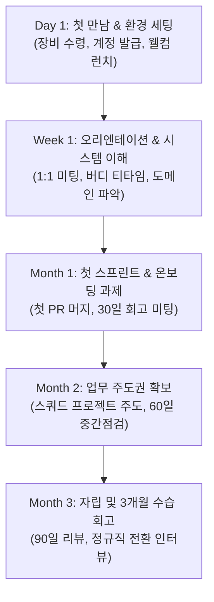

# 02. 온보딩 로드맵 및 체크리스트 (Onboarding Roadmap)

> 온보딩의 목적은 신규 팀원이 회사의 비전과 시스템에 안전하고 신속하게 적응하여,  
> 자신의 잠재력을 최대한 발휘할 수 있는 환경을 마련해 드리는 것입니다.

---

## 🗓️ 3개월 온보딩 여정 요약

---

## 📋 세부 단계별 체크리스트

### 1단계: Day 1 (첫 출근일) - 반가워요, 함께해요!
첫날은 서두르지 않고 오피스 분위기에 적응하고 기본 도구를 세팅하는 날입니다.

- [ ] **오피스 투어 및 자리 배치**
  - 오피스 출입 등록 (지문/모바일 카드 등록)
  - 배정된 좌석 확인, 회의실, 휴게 라운지, 탕비실, 폰부스 위치 확인
- [ ] **웰컴 키트 및 업무 장비 수령**
  - 노트북(맥북 프로 / LG 그램), 듀얼 모니터, 거치대, 키보드/마우스 수령
  - 장비 인수 확인증 서명 및 자산 태그 확인
  - 웰컴 키트 언박싱 (회사 후드티, 텀블러, 웰컴 카드, 스티커 팩)
- [ ] **인사 서류 제출 및 전자계약 체결**
  - 신분증 사본, 통장 사본(급여 수령용), 주민등록등본 제출
  - 근로계약서, 개인정보 처리동의서, 보안 서약서 전자 서명
- [ ] **기본 사내 계정 생성 및 2단계 인증(2FA) 활성화**
  - 구글 워크스페이스 사내 메일 계정(`@chungnamstartapp.com`) 로그인
  - 사내 메신저 슬랙(Slack), 노션(Notion) 초대 수락
  - 사내 비밀번호 관리자(1Password) 및 OTP 세팅
- [ ] **웰컴 런치 (Welcome Lunch)**
  - 팀원들과 함께 여유로운 점심 식사 (회사 지원)
- [ ] **온보딩 버디(Buddy)와의 첫 만남**
  - 지정된 버디와 가벼운 티타임 및 오피스 이용 팁 공유

---

### 2단계: Week 1 (첫 주) - 조직과 프로덕트 이해하기
회사의 서비스 구조와 일하는 방식을 학습하고, 팀원들과 신뢰를 쌓아가는 기간입니다.

- [ ] **사내 온보딩 세션 이수**
  - People팀 세션: 근태, 복리후생, 휴가 제도, 평가/보상 시스템 안내
  - Biz/Product 세션: '충남로컬모아', '스마트 무브' 등 핵심 서비스 지표 및 유저 페르소나 학습
- [ ] **개발/직무 환경 구축 완료**
  - 직무별 필수 권한 획득 (GitHub Organization, AWS Console, Figma, Mixpanel 등)
  - 로컬 개발 환경 셋업 가이드([03_업무도구_및_개발환경_세팅.md](./03_업무도구_및_개발환경_세팅.md)) 실행
  - "Hello World" 빌드 및 로컬 테스트 정상 구동 확인
- [ ] **팀 리드 1 on 1 (기대치 얼라인먼트)**
  - 팀장(리드)과 첫 1:1 미팅을 통해 향후 3개월간의 온보딩 목표와 기대치 합의
- [ ] **팀원 릴레이 커피챗 (Coffee-chat)**
  - 스쿼드 동료 및 유관 부서 팀원 3~4명과 15분 티타임 진행 (회사 커피챗 지원비 활용)
- [ ] **주간 스프린트 플래닝 및 스탠드업 참관**
  - 팀의 주간 일정 공유 및 데일리 스크럼 진행 방식 관찰

---

### 3단계: Month 1 (첫 달) - 작은 성공(Small Win) 경험하기
배운 내용을 바탕으로 실제 프로젝트에 작게 기여해보며 성취감을 느끼는 단계입니다.

- [ ] **온보딩 미니 프로젝트 / Good First Issue 해결**
  - 프로덕트의 사소한 버그 픽스 또는 내부 툴 개선 작업 수행
  - 첫 Pull Request(PR) 생성, 코드 리뷰 프로세스 경험 및 메인 브랜치 머지 배포 완료
- [ ] **사내 문서화 기여 (온보딩 피드백)**
  - 본인이 세팅하면서 겪었던 모호한 점이나 신규 내용을 온보딩 가이드에 직접 업데이트(PR)
- [ ] **30일 온보딩 체크인 (30-Day Check-in)**
  - 팀 리드 및 People팀과 1개월 회고 미팅 진행
  - "현재 적응에 방해되는 장애물이 있는가?", "추가로 필요한 지원은 무엇인가?" 논의

---

### 4단계: Month 2~3 (수습 기간 완주) - 독립성과 오너십 확보
- [ ] **주도적 기능(Feature) 개발 및 릴리즈**
  - 본인이 오너가 되어 기획-개발-QA-배포 전 과정 주도
- [ ] **타운홀(All-hands) 또는 테크 세미나 참여**
  - 사내 월간 공유회에서 가벼운 인사 또는 스터디/배운 점 공유
- [ ] **90일 수습 평가 및 상호 피드백 (90-Day Review)**
  - 본인 자기평가 작성: 지난 3개월의 성과, 핵심 가치 실천 사례, 배운 점
  - 팀원 다면 피드백 및 리드 총평
  - 수습 평가 통과 및 정규 전환 축하 세션 (축하 선물 및 환영 카드 지급)

---

## 🤝 온보딩 버디(Buddy) 프로그램 안내

충남스타트앱컴퍼니는 신규 입사자의 심리적 안정과 원활한 사내 적응을 위해 **전담 버디(Buddy)**를 1:1로 매칭합니다.

### 1. 버디의 역할
- **가장 편안한 질문 창구**: "슬랙 이모지는 어디서 찾나요?", "주변에 커피 맛있는 곳은 어디인가요?" 같은 사소한 질문도 언제든 환영합니다.
- **사내 문화 내비게이터**: 회사의 불문율, 일하는 스타일, 유관 부서와의 협업 팁을 안내합니다.
- **점심 및 휴식 챙김이**: 입사 첫 주 동안 점심을 혼자 먹지 않도록 챙겨주고, 다른 팀원들과 자연스럽게 대화할 수 있도록 이어줍니다.

### 2. 버디 지원비 (Buddy Budget)
- 신규 입사자 1인당 **온보딩 활동비 15만 원** 지원 (첫 달 동안 커피챗, 맛있는 점심, 티타임에 자유롭게 사용 가능)
- 법인카드로 결제 후 영수증 첨부 (`#ask-people` 채널 확인)
