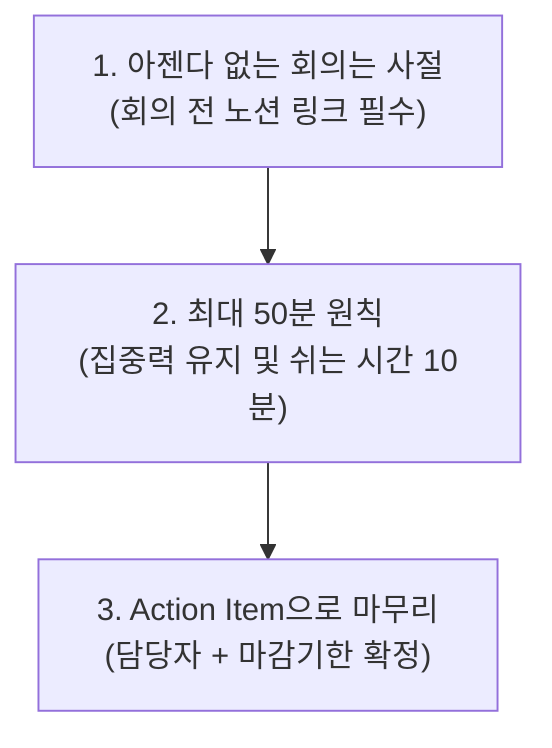

# 04. 근무 제도 및 일하는 방식 (Work Policy & Culture)

> 충남스타트앱컴퍼니는 자율과 책임(Freedom & Responsibility)을 신뢰합니다.  
> 불필요한 출퇴근 통제 대신, 팀원들이 가장 몰입할 수 있는 시간과 공간을 스스로 선택하도록 지원합니다.

---

## 1. 근무 시간 및 시차출퇴근제

우리는 **주 40시간(1일 8시간 + 휴게 1시간)** 근무를 기준으로 하며, 유연한 시차출퇴근제를 운영합니다.

### ⏰ 근무 시간표
- **출근 가능 시간대**: `08:00 ~ 10:30` 사이 자유롭게 출근
- **퇴근 가능 시간대**: 출근 시각으로부터 9시간(점심시간 1시간 포함) 경과 후 자율 퇴근
  - *예 1*: 08:30 출근 ➡️ 17:30 퇴근
  - *예 2*: 10:00 출근 ➡️ 19:00 퇴근
- **코어 타임 (Core Collaboration Time)**: `13:00 ~ 16:00`
  - 팀 간 협업, 전사 회의, 스프린트 미팅을 원활하게 진행하기 위해 **모든 구성원이 근무 상태를 유지해야 하는 필수 시간**입니다.

### 📍 근태 기록 방식
- 사내 근태 관리 솔루션(Flex / Shopl 등 모바일 앱)을 통해 오피스 Wi-Fi 및 GPS 기반으로 원클릭 출퇴근 체크를 진행합니다.

---

## 2. 하이브리드 원격(재택) 근무 제도

우리는 대면 협업의 시너지와 비대면 원격 근무의 높은 몰입도를 모두 존중합니다.

### 🏠 원격 근무 규정
- **이용 가능 대상**: 수습 기간(3개월) 통과 후 정규직 팀원 (수습 기간 중에는 팀 안착을 위해 오피스 출근을 권장하며, 부득이한 경우 리드 승인 하에 재택 가능)
- **사용 일수**: **주 1~2회 자율 재택근무 가능** (팀별 스프린트 회의일 등 고정 오피스 출근일 제외)
- **신청 및 공유 절차**:
  - 전날 18:00까지 사내 근태 시스템에 '재택근무' 등록
  - 당일 아침 출근 시 슬랙 `#remote-work` 채널에 간단히 알림  
    *(예: "홍길동 / 오늘 재택근무 진행합니다. 슬랙/허들 상시 접속 중입니다.")*
- **재택근무 에티켓**:
  - 코어 타임(13:00~16:00)에는 슬랙 메시지 및 구글 미트(Meet)/슬랙 허들(Huddle)에 즉시 응답할 수 있는 환경 유지
  - 화상 미팅 시 카메라 켜기(On)를 기본으로 하여 원활한 비언어적 소통 도모

---

## 3. 휴가 제도 (자율 승인제)

충남스타트앱컴퍼니의 연차 휴가는 **"승인이 아닌 통보"**입니다. 팀원 본인의 휴식은 본인이 결정하며, 상사의 눈치를 보지 않습니다.

### 🏖️ 휴가 종류 및 단위
1. **연차 휴가**:
   - 1년 미만 입사자: 1개월 개근 시 1일 유급휴가 발생 (입사 첫해 총 11일)
   - 1년 이상 근무자: 15일 유급휴가 부여 (근속 연수에 따라 가산)
2. **분할 휴가 (반차 / 반반차)**:
   - **반차 (0.5일 / 4시간)**: 오전 반차(출근 14:00), 오후 반차(퇴근 14:00)
   - **반반차 (0.25일 / 2시간)**: 은행 업무, 병원 방문 등 2시간 단위로 쪼개어 자유롭게 사용
3. **특별 유급휴가**:
   - 경조사 휴가: 본인 결혼(5일), 직계가족 조사(3~5일) 등 사내 취업규칙 기준 지원
   - 여성 보건휴가: 매월 1일 무급/유급(취업규칙 기준) 신청 가능
   - 공가: 예비군/민방위 훈련, 건강검진일(반일 유급) 등

### 📅 휴가 신청 방법
- 사내 근태 앱에서 날짜 선택 후 등록하면 담당 팀장에게 자동 알림(자동 승인).
- 단, 팀 업무 차질을 방지하기 위해 최소 2일 전(장기 휴가는 1주일 전) 팀 캘린더에 사전 공유 권장.

---

## 4. 스마트한 회의 문화 (Meeting Rules)

스타트업에서 가장 비싼 비용은 팀원들의 시간입니다. 우리는 불필요한 회의를 최소화합니다.

### 🚫 수요일은 "회의 없는 날 (No-Meeting Wednesday)"
- 매주 수요일 오후(13:00~18:00)는 전사 **딥 워크(Deep Work) 블록**으로 지정되어 있습니다.
- 긴급한 서비스 장애를 제외하고는 사내 내부 회의 소집이 전면 금지되며, 코딩, 기획서 작성, 디자인 등 개인 몰입 작업에 집중합니다.

---

## 5. 피드백 및 소통 문화

1. **정기 1 on 1 (원온원 미팅)**:
   - 팀 리드와 팀원은 2주 또는 매월 1회, 30분~1시간 동안 1:1 대화를 진행합니다.
   - 업무 진척도 보고가 아닌, **개인의 커리어 성장, 협업 시의 고충, 심리적 지원**을 나누는 시간입니다.
2. **월간 타운홀 미팅 (Townhall / All-hands)**:
   - 매월 마지막 주 금요일 전사 팀원이 모여 경영 실적, 프로덕트 지표, 새로운 팀원 소개, Q&A를 진행합니다.
   - 익명 질문지(Slido)를 통해 대표와 경영진에게 무엇이든 질문할 수 있습니다.
