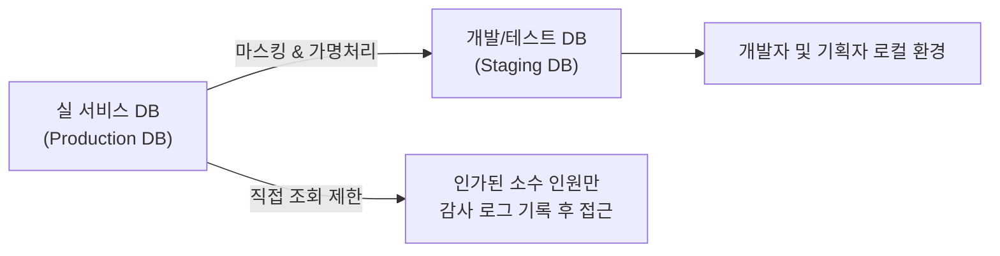

# 06. 정보보안 및 데이터 규정 (Security & Compliance)

> 모바일 플랫폼 스타트업에게 신뢰(Trust)는 생명입니다.  
> 수많은 사용자들의 소중한 개인정보와 서비스 인프라를 지키기 위해, 모든 팀원이 철저한 보안 수칙을 준수해야 합니다.

---

## 1. 계정 및 디바이스 기본 보안

### 🔐 2단계 인증 (2FA / MFA) 필수 적용
모든 사내 계정은 단순 비밀번호 외에 OTP 또는 모바일 인증 앱을 통한 **2단계 인증(2FA) 설정이 의무화**되어 있습니다.

- **대상 서비스**: Google Workspace, GitHub, Slack, AWS Console, Figma, Notion
- **권장 인증 앱**: Google Authenticator 또는 사내 승인 OTP 툴
- **비밀번호 관리**: 모든 업무용 계정은 복잡한 난수 비밀번호를 생성해야 하며, 사내 엔터프라이즈 비밀번호 관리자(1Password) 볼트에 보관합니다.

### 💻 디바이스 관리 및 클린 데스크 (Clean Desk)
- **화면 자동 잠금**: 자리를 비울 때는 즉시 단축키를 눌러 화면을 잠급니다.
  - Windows: `Win + L`
  - Mac: `Cmd + Ctrl + Q` (또는 화면 덮개 닫기)
- **화면 보호기 설정**: 5분 이상 미입력 시 자동 화면 잠금 설정 필수
- **인쇄물 방치 금지**: 회의 자료, 개인정보가 포함된 인쇄물은 책상 위에 방치하지 않고 즉시 파쇄기에 폐기합니다.
- **외부 공용 Wi-Fi 보안**: 카페, 공항 등 외부에서 공용 Wi-Fi 사용 시 반드시 회사 보안 VPN을 활성화하거나 개인 모바일 핫스팟을 이용합니다.

---

## 2. 고객 개인정보 및 운영 데이터 보호

충남스타트앱컴퍼니는 개인정보보호법 및 관계 법령을 엄격히 준수합니다.

### 🚫 개인정보 취급 4대 절대 금지 사항
1. **로컬 다운로드 금지**: 고객의 이름, 전화번호, 이메일, 주소, 결제 정보 등 개인정보(PII)를 로컬 PC 파일(Excel, CSV 등)로 다운로드하는 행위 절대 금지.
2. **사외 메신저 전송 금지**: 고객 정보를 개인 카카오톡, 텔레그램, 개인 이메일로 전송 금지.
3. **공유 드라이브 업로드 주의**: 민감한 고객 데이터가 포함된 문서를 권한 설정 없는 전체 공개 구글 드라이브에 업로드 금지.
4. **테스트 환경에 실데이터 사용 금지**: 개발 및 QA 테스트 시에는 반드시 마스킹 처리된 더미(Mock) 데이터만을 사용합니다.

---

## 3. 개발 보안 및 시크릿(Secret) 관리

모바일 앱 및 백엔드 개발 시 실수로 인한 보안 사고를 사전에 차단합니다.

### 🛡️ 시크릿 키 관리 지침
- **코드 저장소(Git) 커밋 절대 금지**:
  - AWS Access Key, 데이터베이스 접속 비밀번호, JWT 시크릿 키, 카카오/애플 API 키 등
  - `.env`, `credentials.json` 등은 반드시 `.gitignore`에 등록
- **Git Hook 보안 도구(Git-Secrets / Gitleaks) 필수 설치**:
  - 로컬 커밋 시 시크릿 키 패턴이 감지되면 자동으로 커밋이 차단되는 pre-commit 훅 적용
- **혹시라도 커밋이 되었다면?**:
  - 1단계: 즉시 리드 개발자 및 인프라팀에 슬랙 `#ask-it` 채널로 보고
  - 2단계: Git 히스토리 삭제와 별개로, 해당 API 키를 클라우드 콘솔에서 즉각 폐기(Revoke) 및 재발급

---

## 4. 오픈소스 라이선스 및 지식재산권

- **오픈소스 라이선스 준수**:
  - 모바일 앱 및 상용 서비스에 오픈소스 라이브러리를 적용할 때는 라이선스 타입을 반드시 확인합니다.
  - **허용 권장**: MIT, Apache 2.0, BSD (자유롭게 상용 프로젝트 활용 가능)
  - **사전 승인 필수(주의)**: GPL, AGPL 등 소스코드 공개 의무가 발생하는 카피레프트(Copyleft) 라이선스는 도입 전 엔지니어링 리드와 사전 협의 필수
- **회사 지식재산권(IP) 보호**:
  - 재직 중 업무와 관련하여 개발/창작한 모든 소스코드, 디자인 결과물, 기획 문서는 회사의 고유 자산입니다.
  - 회사의 사전 승인 없이 사외 오픈소스 프로젝트에 사내 코드를 복제하거나 외부로 반출할 수 없습니다.
